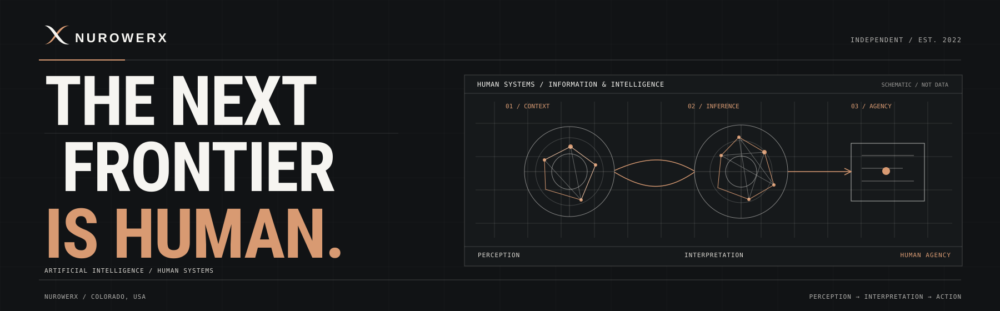

**ARTIFICIAL INTELLIGENCE · HUMAN SYSTEMS · INFORMATION SCIENCE · ADAPTIVE COMPUTING**

**Website:** [nurowerx.com](https://nurowerx.com) · **Contact:** [swalker@nurowerx.com](mailto:swalker@nurowerx.com)

---

Founded in 2022 by Spencer H. Walker, Nurowerx is an independent Colorado-based research and technology company exploring the relationship between people, information, and intelligent systems. Our work connects human–computer interaction, explainable AI, intelligent infrastructure, and adaptive computation with a human-centered perspective.

### Areas of inquiry

**Human–AI Interaction & Explainability**  
Understanding how context, explanations, uncertainty, and intelligent interfaces influence human judgment, trust, and agency.

**AI Infrastructure & Adaptive Computing**  
Exploring model execution, local inference, resource-aware architectures, and the systems that make intelligent computation accessible.

**Perception & Autonomous Systems**  
Research directions in environmental interpretation, sensing, machine-assisted decisions, and meaningful human oversight.

**Information Science & Human Systems**  
Investigating how information is represented, interpreted, communicated, and acted upon across human and artificial systems.

### Research infrastructure: TRACE · LOOP · LENS · FRAME

**[Nurowerx Research Stack — technical overview](./research/RESEARCH-STACK.md)** is a locally implemented, modular research-software environment connecting datasets and evidence to evaluation, visualization, and reviewed corrections.

**TRACE** records structured provenance and relationships · **LOOP** runs evaluations and documents corrections · **LENS** visualizes results and evidence · **FRAME** provides the integrated workspace.

**Reported result:** Dataset → evaluation → reviewed correction → rerun → report workflow completed; **31 tests passed** (browser, accessibility, and mobile coverage), with clean-install and report reproduction verified in the local development report. A **read-only Epistemic Trust Lab import** was reported verified without modifying the existing project.

**Scope:** Developer-reported local implementation; the full source ZIP and engineering report are not public or independently audited here. Resident Model Lab and VEYDRIS remain separate projects, with no integration claim. [Research Stack website overview](https://nurowerx.com/technical-work#research-stack).

### Featured research: Resident Model Lab

**[Resident Model Lab (RML)](https://github.com/Nurowerx/resident-model-lab)** is Nurowerx's experimental research program for **memory-bounded local inference** with existing mixture-of-experts models. Its latest **selection v2** cache keeps the original model router's expert choices intact while improving which weights reside in GPU memory.

**Latest tested result:** Compared with the previous 256-slot default, the new 128-slot configuration used **38.3% less peak GPU tensor memory** (2.42 vs. 3.92 GiB) at **11.4% higher mean response latency** (16.19 vs. 14.53 seconds). At a matched 128-slot capacity, the new cache policy was **6.3% faster** than the previous cache. An audit matched generated tokens across **128 requests**, full next-token logits were bitwise equal on three selected prompts, and **24 tests passed**.

**Scope:** This is a small, controlled OLMoE engineering study, **not** a claim of universal model compression, broad capability equivalence, or lower total system cost. The full expert store remains local, and raw results have not been independently audited here. Earlier approximate expert substitution degraded some answers; selection v2 instead preserves native routing.

**Explore:** [RML canonical project repository](https://github.com/Nurowerx/resident-model-lab) (**private; collaborators only**) · [Public RML research note, v0.2](./research/RESIDENT-MODEL-LAB.md) (**accessible without repository access**).

### Applied computer vision: VEYDRIS

**[VEYDRIS — technical overview](./research/VEYDRIS.md)** is a locally implemented video-analysis prototype featuring object detection and tracking in uploaded recordings, replay, annotations, exports, and authentication, plus a separately labeled **synthetic map demo**. The initial developer-reported build passed **36 automated tests**.

**Scope:** The software has not been independently audited from its complete source archive. Live drone connections and real geolocation are future phases; included Docker/PostGIS configuration remains runtime-untested. The local application, model, and sample archive are **not yet publicly released**. No live operational sensing or measured field accuracy is claimed.

### Founder research: Epistemic Trust Lab

**[Epistemic Trust Lab](./research/EPISTEMIC-TRUST-LAB.md)** is an independent research instrument created by Nurowerx founder Spencer H. Walker to investigate evidential support, conversational context, and AI reliability. The reported local implementation includes **240 synthetic scenarios, 5,760 deterministic policy evaluations,** interactive memory/evidence inspection, and **34 passing automated tests**.

**Scope:** Synthetic deterministic evaluations only. Real-model benchmarking and authorized human-participant research have not been completed, and the source archive is not yet publicly released. This founder-led project is not represented as company-sponsored or university-sponsored research.

### Public technical work

This organization provides a deliberately limited public view of Nurowerx's research and engineering directions. Public repositories will be selected for clarity, reproducibility, and suitability for release.

Proprietary implementations, experimental systems, confidential engagements, and unpublished research remain private unless deliberately cleared for publication.

---

NUROWERX · Colorado, United States · [Official website](https://nurowerx.com) · Independent research and technical development
