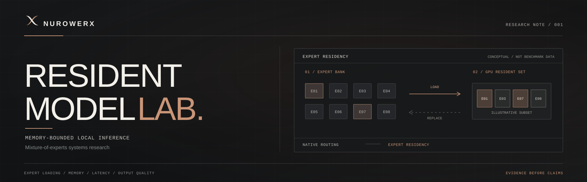

  

# Resident Model Lab

## Preliminary technical research note

**Nurowerx | Active research | Version 0.2 (selection v2) | November 2026**

> **Disclosure:** This is an engineering research summary based on team-supplied measurements and audits. It is not peer-reviewed, independently replicated, or a public release of the implementation, model weights or full benchmark artifacts. The [RML source repository](https://github.com/Nurowerx/resident-model-lab) is **private**, so only authorized collaborators can open it.

### Overview

**Resident Model Lab (RML)** investigates memory-bounded local inference with an **existing OLMoE mixture-of-experts language model**. Its focus is the systems problem of which expert weights should be resident in fast GPU memory and when missing experts should load from local storage. Nurowerx develops the surrounding runtime and experimental software, **not the underlying foundation model**.

An MoE *expert* is a mathematical model component, not necessarily a domain specialist.

### Key finding: router-faithful residency (selection v2)

The earlier restricted adaptive selector could substitute different experts for those requested by the native model router and degraded some answers. **Selection v2 does not substitute experts.** It uses layer-partitioned caches with request protection to decide which weights **stay in GPU memory**, while always executing the router's original expert choices.

The team reported these results on one OLMoE/RTX 5070 configuration:

| Cache strategy | Peak GPU tensors | Mean request time (empty application cache) |
| --- | ---: | ---: |
| Prior global LRU, 256 slots | 3.92 GiB | 14.53 s |
| New layer-partitioned cache, 256 slots | 3.92 GiB | **13.10 s** |
| Prior global LRU, 128 slots | 2.42 GiB | 17.28 s |
| New layer-partitioned cache, 128 slots | **2.42 GiB** | **16.19 s** |

**Memory-versus-speed:** The new 128-slot setting used **38.3% less peak GPU tensor memory** than the prior 256-slot default at **11.4% more request latency**. The smaller capacity itself accounts for the memory reduction. At the **same** 128-slot capacity, the new policy was **6.3% faster** and incurred **13.6% fewer logical expert reads**; at the same 256-slot capacity, it was **9.9% faster** with **4.8% fewer reads**.

**Correctness evidence:** An audit found identical generated tokens for **128 requests** comprising 16 tasks, two cache conditions and four configurations. Full next-token logits were **bitwise equal** on three selected prompts in empty and warm conditions; **24 tests passed**. All configurations solved **10/16** engineering tasks correctly, preserving baseline errors alongside baseline successes.

The experiment is small, and these findings **do not establish universal speedups, general capability preservation, lower total machine memory, or hardware-cost savings**. The complete approximate **12 GiB expert store still remains on local storage**.

### Earlier v0.1 negative result

An initial eight-task evaluation compared exact execution, ordinary quantization and restricted adaptive expert substitution. Exact and quantized baselines each passed **5/8** tasks; the restricted adaptive 16-expert methods passed **2/8**. These results motivated the switch toward router-faithful residency. They are historical and should **not** be confused with the current exact-residency cache.

### Limits and next experiments

The new study used 16 engineering tasks, only eight of them new and independent. The four configurations each received one serial, non-randomized pass. Timing can be influenced by OS caching, thermals and unrelated CPU work. "Logical reads" are not direct physical SSD read measurements. The study combined layer partitioning with request protection rather than testing them individually. A small audit does not prove exact results on all inputs or longer contexts.

Next steps include larger independent benchmark suites, longer contexts, multiple randomized repetitions, isolated mechanism studies, host-memory constraints, and comparing synchronous exact loading with safe opportunities for overlapped transfers.

### Project links and source availability

- **[RML technical repository](https://github.com/Nurowerx/resident-model-lab)** — canonical project source location; **private**, access restricted.
- **[Selection v2 technical summary](https://github.com/Nurowerx/resident-model-lab/blob/main/docs/selection-v2-results.md)** — available to authorized repository collaborators.
- This document is the **public research note** for readers without repository access.

No source code, checkpoints, raw private experimental fixtures or credentials are published through this note. Related research exists, including MoE-Infinity and MoE-CORE; this small experiment should not be described as a universal compression approach or entirely new MoE architecture.

---

*Nurowerx · Independent research and technical development · Colorado, USA*
